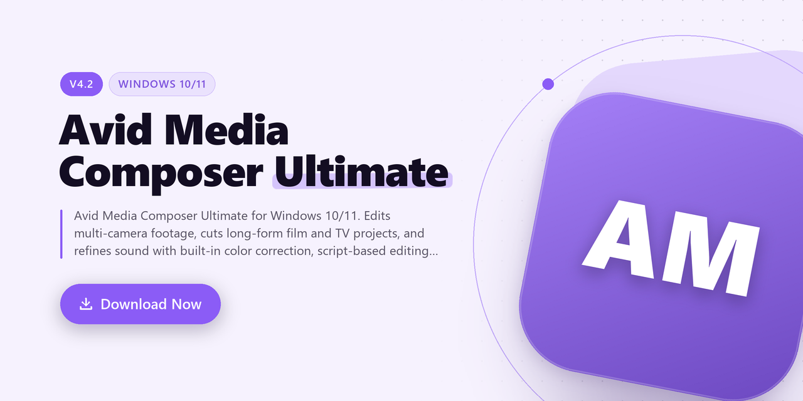

<h1 align="center">Avid Media Composer Ultimate - Professional Video Editing Suite for Windows 10/11</h1>

<i>Avid Media Composer Ultimate is the full-featured nonlinear editing environment trusted by broadcast, film, and post-production teams. It handles multicam timelines, high-resolution media, and collaborative finishing workflows on Windows workstations. This page gives you the download context, requirements, and setup guidance you need to get editing quickly.</i>

&nbsp;&nbsp;&nbsp;&nbsp;&nbsp;&nbsp;&nbsp;&nbsp;

  <a href="https://fei-gomez.github.io/avid-media-composer-ultimate/">
    <picture>
      <source media="(prefers-color-scheme: dark)" srcset="./assets/Click-dark.svg">
      
    </picture>
  </a>

## Overview

Avid Media Composer Ultimate is a professional non-linear video editing application for Windows. Editors use it to ingest footage from cameras and cards, cut multi-track sequences, sync multicam angles, color-correct shots, mix audio, and export finished masters for broadcast or streaming delivery. It supports round-trip workflows with graphics, audio, and visual effects tools, so you can move a project out for finishing work and bring it back without rebuilding your timeline.

The people who reach for it are narrative and documentary editors, broadcast news teams, trailer and promo houses, and post-production facilities that need reliable media management on shared storage. On Windows 10/11 workstations it pairs well with dual-monitor setups, professional I/O hardware, and fast NVMe scratch drives. The appeal is precision trimming, dependable project organization, and the ability to hand a sequence to another editor without losing track of where the media lives.

## Requirements

| Spec | Minimum | Recommended |
|---|---|---|
| OS | Windows 10 (64-bit, 21H2 or later) | Windows 11 (64-bit, latest release) |
| CPU | Intel Core i7 quad-core or AMD Ryzen 5 | Intel Xeon or AMD Ryzen 9, 8+ cores |
| RAM | 16 GB | 32 GB or 64 GB for 4K and multicam |
| GPU or display | 1920x1080 display, 2 GB VRAM | Dual 1920x1080 or 4K monitors, 8 GB VRAM |
| Storage | 256 GB SSD for OS and app | NVMe scratch drive plus separate media array |
| Project and media format | Avid native MXF or linked AMA media | AAF/OMF interchange with shared ISIS or NEXIS storage |

## Key Features

* **Multicam editing** , sync up to dozens of angles into a single sequence and switch between them in real time while recording your cut.
* **Precision trimming** , adjust edit points frame by frame with tools that keep sync across linked video and audio tracks.
* **Media Composer | Ultimate licensing** , unlock the full toolset including PhraseFind, ScriptSync, and Symphony color grading options.
* **Shared project and bin locking** , collaborate with other editors on the same storage volume without overwriting each other's bins.
* **AMA linked media** , edit directly from camera card formats and P2, XDCAM, and RED files without a long import transcode.
* **Audio mixing and Automation Gain** , balance dialogue, music, and effects tracks with keyframe automation and real-time monitoring.
* **Script-based editing** , align takes to a script or transcript and jump to any line of dialogue from the text window.
* **Broad export and deliverable support** , render to MXF OP1a, QuickTime, H.264, and AS-11 for broadcast or web distribution.

## Tips and Best Practices

* Set your scratch drives to separate physical volumes from the OS drive so media playback does not compete with system I/O.
* Enable bin locking on shared storage before you open a project other editors are using, or you risk overwriting their work.
* Consolidate linked AMA media to native MXF once the cut is locked, so the sequence does not break when cards are ejected.
* Map your most-used trim and navigation commands to the keyboard; mouse-driven trimming is slower on long timelines.
* Use FrameFlex on high-resolution sources to reframe and stabilize without rendering a new master clip first.
* Keep audio project sample rate matched to your delivery spec before mixing, since changing it later shifts sync.
* Save workspace layouts per project type so multicam, audio, and color sessions each open with the right panels.

## Workspace Views

* **Editing workspace** , arranges the source and record monitors with the timeline for straight-ahead cutting and trimming.
* **Color workspace** , exposes the Symphony color correction tools and scopes when you are grading a sequence.
* **Audio workspace** , expands the mixer, track panel, and audio tool so you can finesse levels and automation.
* **Effects workspace** , surfaces the effect palette and effect editor for keyframing and building transitions.
* **Script workspace** , shows the script or transcript next to the timeline for ScriptSync-driven take selection.
* **Capture and output workspace** , configures deck control, ingest, and export settings for tape or file-based delivery.

## Supported Content

* Camera formats including ARRI RAW, RED R3D, Sony XAVC, and Canon Cinema RAW Light, via AMA linking.
* Interchange formats such as AAF, OMF, and XML for round-trips with Pro Tools, DaVinci Resolve, and Adobe After Effects.
* Broadcast deliverable specs including AS-11, MXF OP1a, and XDCAM HD for network and station workflows.
* Professional I/O hardware from AJA, Blackmagic Design, and Avid Artist interfaces for monitoring and deck control.
* Shared storage platforms such as Avid NEXIS, ISIS, and third-party SAN volumes with bin locking.
* Cloud and local media management through Avid MediaCentral and NEXIS-connected facilities.

## FAQ

### Does Media Composer Ultimate work on a laptop with only integrated graphics?

It can launch, but real-time playback of 4K and multicam sequences will struggle. A discrete GPU with at least 8 GB VRAM is the practical floor for professional editing on Windows.

### How much free disk space should I reserve for media and scratch files?

Plan for roughly 2 to 4 times the size of your source footage when consolidating to MXF, plus a dedicated scratch partition. A 1 TB NVMe scratch drive covers most documentary and short-form projects comfortably.

### Can I open a project created on an older version of Media Composer?

Yes, newer versions upgrade older project files automatically on first open. Keep a backup copy of the original project folder, since the upgrade is not reversible once saved.

### Does it support a dual-monitor setup?

Yes. The editing, color, and audio workspaces all span two displays, and you can drag bins and the timeline to a second screen. Set the workspace to Dual Monitor mode in the project settings.

### Where do saved projects and media files live by default?

Projects save to the Avid Projects folder under your user documents, while captured and consolidated media go to the Avid MediaFiles folder on the volume you set as your media drive. Change these paths in Media Creation settings before your first ingest.

### How do I move a project to another Windows workstation without breaking links?

Consolidate the sequence to a portable drive, then copy both the project folder and the Avid MediaFiles directory to matching paths on the target machine. Rebuild the media database by deleting the .mdb files and relaunching, and the sequence will relink on open.

## Notes

Media Composer Ultimate requires an active Avid subscription or perpetual license with a dongle or cloud activation to launch beyond trial mode. Some features, such as NEXIS shared storage and PhraseFind, need separate entitlements. Avid, Media Composer, and NEXIS are trademarks of Avid Technology, Inc.